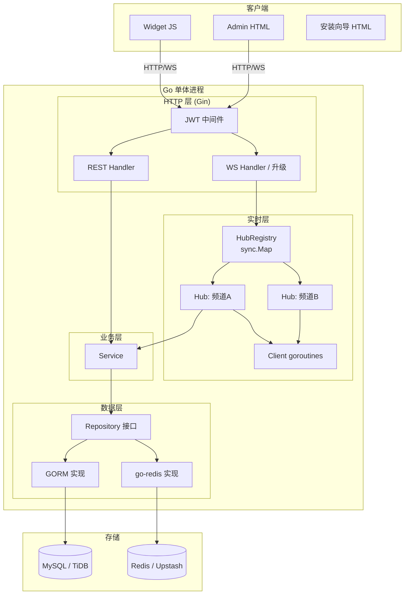
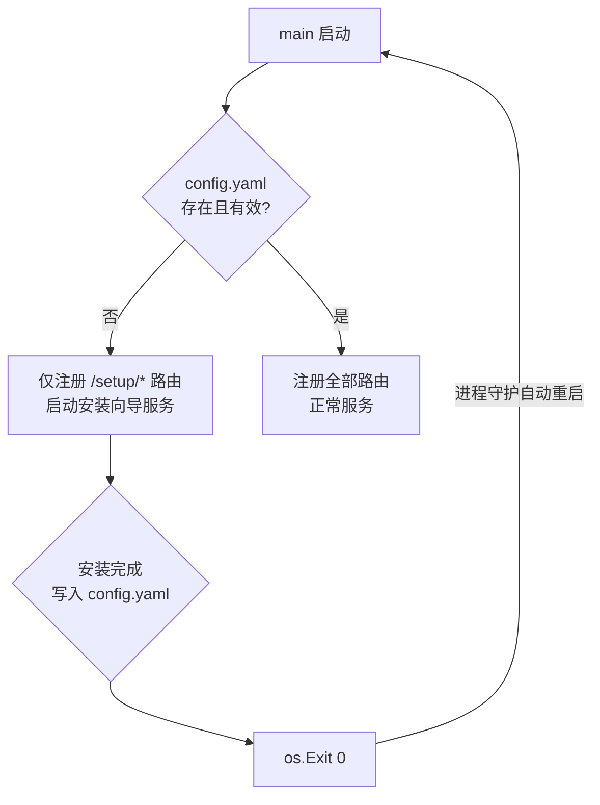
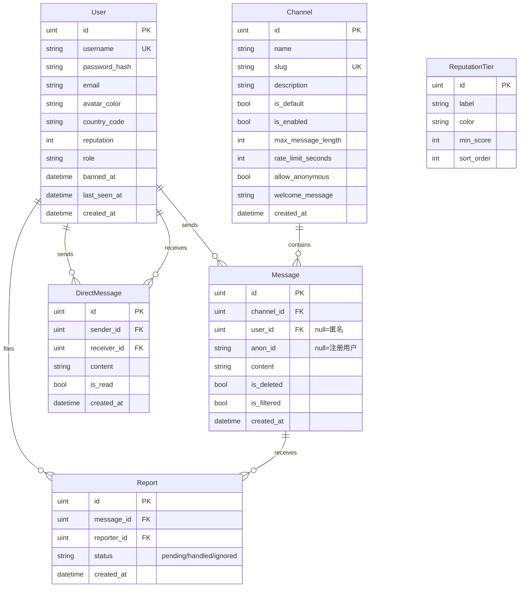
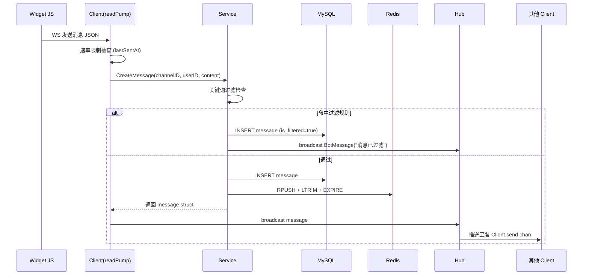
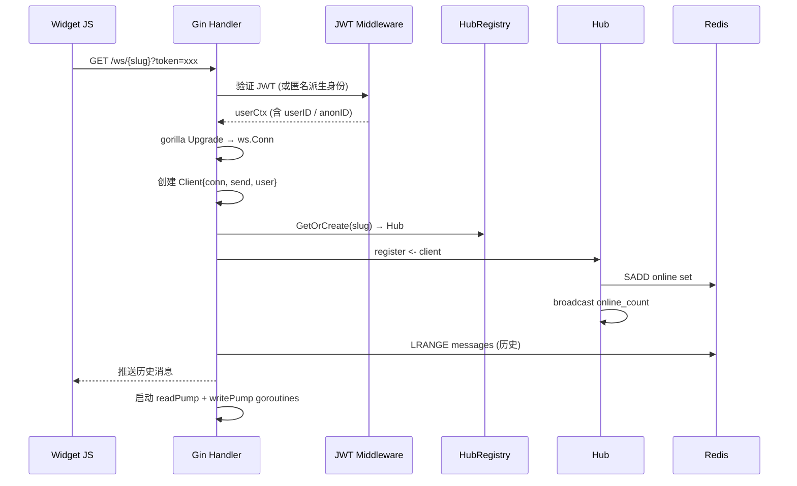
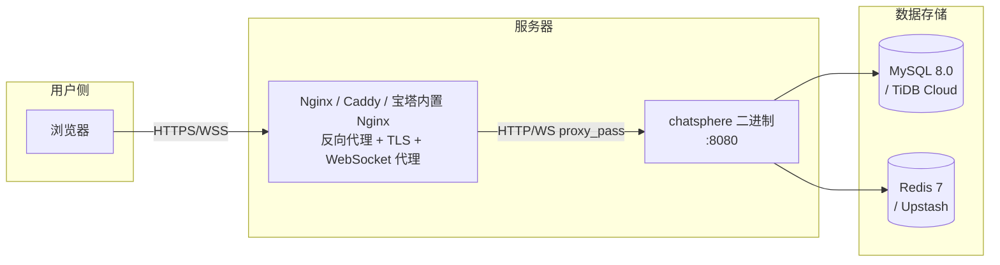

# ChatSphere Architecture Spine

## Paradigm

**分层单体 + 事件驱动实时核心（AD-1）**

标准四层结构（handler → service → repository → model）处理所有 HTTP/REST 逻辑；独立的 WebSocket Hub goroutine 体系处理实时消息扇出。两条通路共享 service 层和 repository 层，不互相侵入。



---

## Architecture Decisions

### AD-1 — 范式：分层单体 + 实时核心
**Binds:** 整个系统结构
**Prevents:** handler 直接操作 DB；Hub 逻辑泄漏进 HTTP handler；service 感知 WebSocket 协议
**Rule:** HTTP 通路和 WebSocket 通路在 handler 层分叉，共享 service + repository 层；任何消息广播调用必须由 Hub 发起，service 只返回数据。

---

### AD-2 — 包边界
**Binds:** 代码目录结构和导入规则
**Prevents:** 循环依赖；外部包绕过 internal 访问内部实现
**Rule:**

```
cmd/chatsphere/         ← main.go，只做装配
internal/
  config/               ← 配置加载与校验 (config.yaml → struct)
  installer/            ← 安装向导 HTTP handler（仅安装模式注册）
  database/             ← GORM 初始化、AutoMigrate
  cache/                ← go-redis 客户端封装
  model/                ← GORM 模型（User, Channel, Message, Report, DirectMessage）
  repository/           ← 接口定义 + GORM/Redis 实现
  service/              ← 业务逻辑，依赖 repository 接口
  handler/              ← Gin HTTP handler（auth, chat, admin, widget）
  ws/                   ← Hub, Client, HubRegistry
  middleware/           ← JWT 鉴权, Rate limit 检查
  i18n/                 ← 翻译包 (en, zh-CN)
web/                    ← go:embed 嵌入目标（widget/, admin/, installer/）
deploy/
  docker-compose.yml
```

导入方向：`cmd` → `internal/*`；`internal/handler` → `internal/service` → `internal/repository` → `internal/model`；`internal/ws` → `internal/service`（单向）。**禁止跨层跳跃导入。**

---

### AD-3 — WebSocket Hub 设计
**Binds:** 实时消息扇出机制
**Prevents:** 多个 goroutine 并发写同一 WebSocket 连接；Hub 状态散落在 handler 层
**Rule:**

```mermaid
graph LR
    subgraph "HubRegistry (sync.Map)"
        HR["slug → *Hub"]
    end

    subgraph "Hub goroutine (每频道一个)"
        BC[broadcast chan Message]
        RG[register chan *Client]
        UG[unregister chan *Client]
        CM[clients map]
        RUN[Run loop]
    end

    subgraph "Client (每连接两 goroutine)"
        RP[readPump]
        WP[writePump]
        SC[send chan []byte]
    end

    HR --> RUN
    RP -->|发消息| BC
    RUN -->|fan-out| SC
    SC --> WP
    RUN -->|维护| CM
```

- `HubRegistry` 用 `sync.Map`，key = channel slug；Hub 按需懒创建，无活跃连接时不销毁（保留在线计数一致性）
- `writePump` 是唯一向 `websocket.Conn` 写数据的 goroutine（gorilla/websocket 单写者原则）
- `readPump` 负责读取客户端消息 → 调用 service 写入 → 推入 `Hub.broadcast`
- 心跳：`readPump` 设置 60s read deadline；`writePump` 每 54s 发 PingMessage

---

### AD-4 — WebSocket 鉴权
**Binds:** WS 连接建立时的身份识别
**Prevents:** 连接建立后的身份变更；未鉴权消息进入 Hub
**Rule:**
- 注册用户：`?token=<JWT>` query param 随 WS 握手传入，Gin handler 在 `gorilla.Upgrader.CheckOrigin` 或升级前提取并验证
- 匿名用户：无 token → `identity = SHA-256(RemoteAddr IP + server_salt)[:8]`，名称由服务端双词组合生成
- 身份元数据在 `Client` 结构体初始化时固定，连接生命周期内不可变
- 封禁用户：JWT 有效但 `user.banned_at != nil` → 升级前拒绝（HTTP 403）

---

### AD-5 — 状态所有权与消息写入顺序
**Binds:** 消息持久化和在线计数的一致性语义
**Prevents:** Redis 和 MySQL 双写顺序颠倒导致客户端读到未持久化的消息
**Rule:**

**消息写入顺序（严格）：**
1. INSERT MySQL `messages` 表（获取稳定 ID）
2. RPUSH + LTRIM + EXPIRE Redis List（`chatsphere:channel:{slug}:messages`，最多500条，TTL 24h）
3. `Hub.broadcast <- message`（广播给在线客户端）

步骤 1 失败 → 中止，返回错误，不进入步骤 2/3。步骤 2/3 失败 → 记录日志，不回滚 MySQL（Redis 是可丢失缓存）。

**在线计数：**
- 连接成功：`SADD chatsphere:channel:{slug}:online {userID/anonID}`
- 断开：`SREM`；Hub 在 unregister 时同步调用
- 广播时机：每次 register/unregister 后，Hub 通过 `SCARD` 获取最新数，推送 `{type:"online_count", count:N}` 给所有客户端

---

### AD-6 — 配置生命周期与安装流程
**Binds:** 进程启动行为和安装向导触发逻辑
**Prevents:** 安装向导和正常服务同时运行；config.yaml 不存在时正常路由被注册
**Rule:**



安装完成后调用 `os.Exit(0)`，由各部署方式的进程守护机制负责自动重启，重启后 config.yaml 已存在，进入正常服务模式。三种目标部署环境均支持此模式：

| 部署方式 | 进程守护 | 配置要点 |
|---------|---------|---------|
| Docker | `restart: always`（docker-compose.yml 默认） | 无需额外配置 |
| Linux 裸机 | systemd unit `Restart=always` + `RestartSec=2` | 文档提供 `chatsphere.service` 模板 |
| 宝塔面板 | 宝塔「Go 项目」管理器，开启「开机自启」和「异常重启」 | 文档说明宝塔项目配置步骤 |

---

### AD-7 — 静态资源嵌入
**Binds:** 编译产物结构和资源服务方式
**Prevents:** 运行时找不到静态文件；部署依赖外部文件系统
**Rule:**
```go
//go:embed web/widget web/admin web/installer
var staticFS embed.FS
```
- Widget: `GET /widget/chatsphere.js`, `/widget/chatsphere.css`（无鉴权）
- Admin: `GET /admin/*` 静态文件（JWT 中间件保护）
- Installer: 仅安装模式注册 `GET /setup/*`

---

### AD-8 — Admin 渲染策略
**Binds:** 管理后台前端实现方式
**Prevents:** 引入 Node.js 构建工具链；后台 JS bundle 体积膨胀
**Rule:** 服务端 `html/template` 渲染完整 HTML 页面；动态交互（搜索、筛选、表单提交）使用原生 JS `fetch` + 局部 DOM 更新。无 React/Vue/HTMX 依赖。

---

### AD-9 — Widget JS 架构
**Binds:** Widget 前端的边界和通信协议
**Prevents:** Widget 污染宿主页面样式；Widget 引入外部 CDN 依赖影响加载性能
**Rule:**
- 单文件 `chatsphere.js`，无运行时外部依赖
- 所有 CSS 以 `[data-cs="root"]` 为根作用域（不用 Shadow DOM，v1 兼容性优先）`[ASSUMPTION]`
- 通信：WebSocket（实时收发）+ REST `fetch`（登录/注册/加载历史/举报）
- 目标体积：< 30KB gzipped
- 通过 `window.ChatSphere.init(opts)` 或 `data-*` 属性初始化，支持同一页面多频道实例

---

### AD-10 — 水平扩展路径（v1 不实现）
**Binds:** v1 部署拓扑和 v2 演进约束
**Prevents:** v1 架构无意中阻断 v2 扩展路径
**Rule:** v1 单实例部署；Hub 状态在进程内。v2 水平扩展两条路径（不选择，v1 不实现）：
- **粘性会话**：nginx `ip_hash`，各实例 Hub 独立，简单
- **Redis pub/sub 扇出**：Hub 订阅 Redis channel，消息跨实例广播，无状态
v1 代码中 Hub 的消息广播调用必须只通过 `Hub.broadcast chan` 进入，不直接调用客户端方法——以保持该边界可被 Redis pub/sub 替换。

---

### AD-11 — Repository 模式
**Binds:** service 层和数据层之间的依赖方向
**Prevents:** service 层直接持有 `*gorm.DB` 或 `*redis.Client`；handler 直接操作 DB
**Rule:** 每个实体（User, Channel, Message, Report, DirectMessage）在 `internal/repository` 下定义 Go interface；`internal/service` 仅依赖这些接口。GORM 实现和 Redis 实现分别在同一包下的独立文件中。

---

### AD-12 — 错误处理约定
**Binds:** 全系统错误格式和日志级别
**Prevents:** handler 直接返回 Go error 字符串暴露内部细节；WebSocket 错误无结构
**Rule:**
- HTTP: `{"error": "<用户可见消息>", "code": "<机器可读 snake_case 代码>"}` + 对应 HTTP 状态码
- WebSocket: `{"type": "error", "code": "<code>", "message": "<用户可见消息>"}`
- 内部错误（DB/Redis 失败）记录 `ERROR` 级日志，用户侧返回通用消息（不暴露 SQL/stack）
- 使用 Go 标准 `log/slog` 结构化日志（无第三方日志库）`[ASSUMPTION]`

---

### AD-13 — DM 加密策略（v1 明文）
**Binds:** DM 消息的存储和管理员配置语义
**Prevents:** v1 误实现残缺 E2E 加密给用户安全假象
**Rule:** v1 DM 消息 MySQL 明文存储；管理员后台「私信加密」开关仅写入 `config.yaml` flag，**不实际执行加密逻辑**，界面标注「功能在后续版本启用」。真实 E2E 加密（WebCrypto API 客户端密钥协商）推迟至 v2。

---

## 数据模型（Seed）



---

## 关键序列图

### 消息发送完整流程



### WS 连接建立



---

## 部署拓扑（v1）

三种交付部署方式，拓扑结构相同，进程守护和数据库来源不同：



| 部署方式 | 二进制 | 进程守护 | MySQL | Redis | 反向代理 |
|---------|--------|---------|-------|-------|---------|
| **Docker** | 容器内 | `restart: always` | 容器 mysql:8.0 或 TiDB Cloud | 容器 redis:7-alpine 或 Upstash | Nginx/Caddy 容器或宿主 |
| **Linux 裸机** | 直接运行 | systemd `Restart=always` | 宿主 MySQL 或 TiDB Cloud | 宿主 Redis 或 Upstash | Nginx/Caddy |
| **宝塔面板** | 上传至服务器 | 宝塔 Go 项目管理器「异常重启」 | 宝塔 MySQL 插件 或 TiDB Cloud | 宝塔 Redis 插件 或 Upstash | 宝塔 Nginx 站点 + 反代配置 |

**Nginx WebSocket 代理关键配置（三种方式均需）：**
```nginx
location / {
    proxy_pass http://127.0.0.1:8080;
    proxy_http_version 1.1;
    proxy_set_header Upgrade $http_upgrade;
    proxy_set_header Connection "upgrade";
    proxy_set_header Host $host;
    proxy_read_timeout 3600s;   # WebSocket 长连接
}
```

文档交付：Docker Compose 文件 + systemd unit 模板 + 宝塔配置步骤说明（三份并列）。

---

## Deferred（本脊骨不决定）

| 项目 | 理由 |
|------|------|
| Widget CSS 隔离方案（Shadow DOM vs namespace） | v1 用 `[data-cs="root"]` namespace 足够；Shadow DOM 兼容性权衡留给实现者 |
| Admin 动态交互具体实现（HTMX vs fetch） | 不影响其他单元，实现者自由选择 |
| @ 提醒音效格式（MP3 vs OGG） | 浏览器兼容性细节，不跨单元 |
| 结构化日志库选择（slog vs zap） | 仅影响 `internal/logger`，不跨层 |
| v2 E2E 加密协议（ECDH / WebCrypto） | v1 明文，v2 独立迭代 |
| v2 水平扩展方案选择（粘性会话 vs Redis pub/sub） | v1 单实例，AD-10 保留演进空间 |
| 授权码/许可证系统（License key 验证） | 商业功能，不影响核心架构 |
